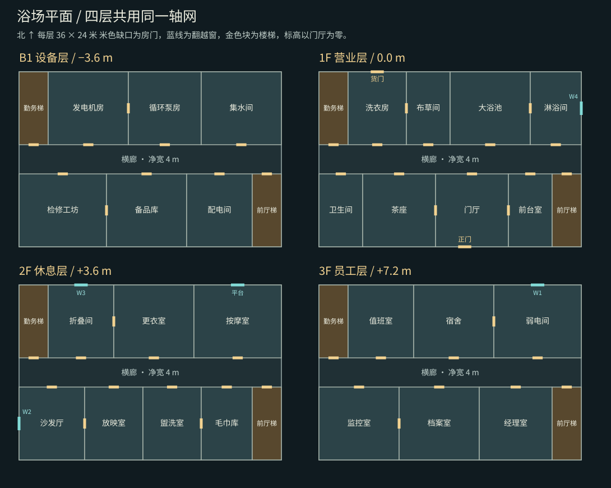
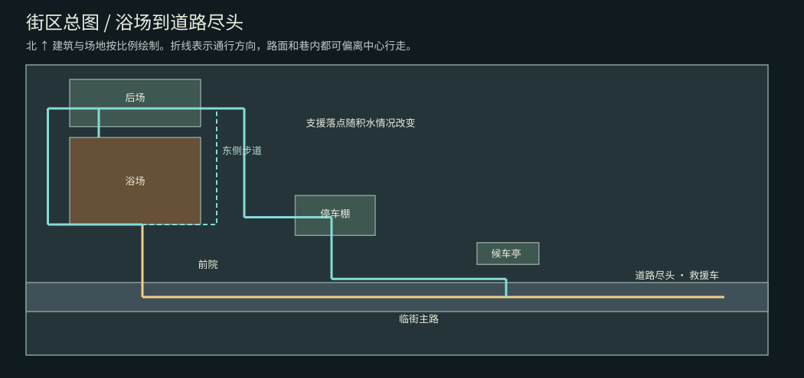

# 奶娃浴场：打烊后 · 总场景与第一夜

**设计基线 v1 · 待 Unity 白盒试玩。** 玩家在二楼更衣室醒来。热水管还在响，楼下前台的电话却没电。隔着门厅玻璃，能看清街道尽头的公交站牌。玩家从开局就可以走到那里，想让救援车出现，得先让外界知道这栋楼里还有人。

## 一栋楼，两座梯，一条街

Unity 采用 1 单位等于 1 米，Y 向上，北为 +Z。**建筑外廓 36 × 24 米，四层合计约 3,456 平方米，27 间可进入的房间。** 楼梯、走廊、室外平台和后场不计入房间数。下表的两个房间序列都从西往东读，与图中位置一一对应。

| 楼层与地坪 | 横廊北侧 | 横廊南侧 | 用途 |
| --- | --- | --- | --- |
| B1，−3.6 m，6 间 | 发电机房、循环泵房、集水间 | 检修工坊、备品库、配电间 | 工具与供电。发电机启动后，检修工坊变成能掩盖轻脚步的地方 |
| 1F，0 m，8 间 | 洗衣房、布草间、大浴池、淋浴间 | 卫生间、茶座、门厅、前台室 | 求援终端与内外分流。前台玻璃可以同时看见正门和前厅梯 |
| 2F，+3.6 m，7 间 | 折叠间、更衣室、按摩室 | 沙发厅、放映室、盥洗室、毛巾库 | 出生、手电和漏水源。更衣室左连折叠间，首次遭遇就有第二条退路 |
| 3F，+7.2 m，6 间 | 值班室、宿舍、弱电间 | 监控室、档案室、经理室 | Wi-Fi 上行、街区监控和员工生活痕迹。弱电间有两个门和一个外窗 |

**定位基准。** 以正门外沿中心为地面原点。建筑西墙 X=−20，东墙 X=16，南墙 Z=0，北墙 Z=24。东西走廊净宽 4 米，居中贯通。西北角的勤务梯、东南角的前厅梯各占 4 × 10 米，四层上下对齐，目标梯段净宽分别为 1.5 米和 2 米。房门通行净宽先取 1.2 米；白盒用玩家和奶娃实际碰撞体复测。

### 哪些门一开始就能走

- **常开。** 正门、后场货门、两座楼梯的地上段、全部横廊，以及门厅、茶座、大浴池、更衣室、沙发厅的走廊入口。正门和后场之间始终有室外西侧通道。
- **常闭、可双向推开。** 其余房间的走廊门与图中的相邻房间连通门。推门能切断视线，快推和慢推的声响不同。B1 经勤务梯开局可往返。
- **一个单向首开点。** B1 前厅梯防火门从地下侧推开后扣在开启位，此后双向通行。初次下楼可以走西梯，惊动奶娃后从东梯绕回；也可以一路从西梯撤退。维修完成与否不影响这条退路。
- **能绕一圈的例子。** 前台室 → 门厅 → 茶座 → 横廊 → 前台室；更衣室 → 折叠间 → 横廊 → 更衣室；弱电间 → 宿舍 → 横廊 → 弱电间。奶娃能走相同的门和楼梯。电力、排水与网络影响照明、声场和救援条件，房间准入不靠搜集钥匙。

### 四处可翻越的窗

窗框带磨亮的下沿，从窗内就能看见下一处落脚面。翻越是明确的交互，落点始终可继续走。其余玻璃用固定框、磨砂面或限位器区别。奶娃能听见落地声，只能沿实际连通路线绕行。

| 窗 | 从哪里到哪里 | 玩家在交换什么 |
| --- | --- | --- |
| W1 | 3F 弱电间北窗 → 半层检修平台 → 2F 按摩室北露台门 | 最快脱离三楼，金属平台很响。露台门常开，只能向下跨第一段 |
| W2 | 2F 沙发厅西窗 → 茶座侧面的布雨棚 → 1F 室外西通道 | 软面落脚较轻，第二段会暴露在前院灯下 |
| W3 | 2F 折叠间北窗 → 半层卸货平台 → 1F 洗衣房货门外 | 落地后可回屋或进后巷。空货架震动，附近玩家和奶娃都能听见 |
| W4 | 1F 淋浴间东窗 ↔ 东侧排水步道 → 后场或前院 | 齐腰低窗可双向翻越。能绕开门厅，浅水会留下短暂可见的湿脚印 |

W1–W3 的半层落脚面分别放在 +5.4、+1.8、+1.8 米，白盒逐段做落点胶囊净空和防卡测试。地下室使用两座楼梯撤离。

## 门外也要玩

室外边界为 X=−32…172、Z=−36…44 米，总场地 **204 × 80 米**。正门向南 20 米上路，再向东 160 米到接应点，约 **180 米**。进入东端后看见封路路障、站牌和掉头位，那里是救援车停车的位置。开局抵达只会看见空站台，站牌背面有浴场前台的应急联络说明。

| 地段 | 玩法 |
| --- | --- |
| 门外至西侧绕行巷 | 在正门能判断巴士站方向。车身、矮墙和广告板切断部分视线。退回茶座、绕后场或沿路往东都成立 |
| 后场与停车棚 | 后场连洗衣房；后巷在停车棚重新接回主路。停车棚有可穿过的维修沟，也能听出奶娃沿碎石还是柏油靠近 |
| 候车亭至道路尽头 | 亭中线路图标出街段。末段可沿车道冲刺，也能沿停靠车与围栏间的路肩前进；两线在救援车侧门合流 |

## 第一夜怎么走

单人首次体验目标 **25–40 分钟**，熟悉布局后可以提前准备零件或分段撤走。以下时间用于试玩调节。主线依赖为 **电源就绪 + 网络线路接好 → 前台呼叫 → 确定接应点 → 登车**。水槽和空投是可选项。跳过两者也能完成求援和撤离。

| 段落 | 玩家实际做什么 | 场景怎样回应 |
| --- | --- | --- |
| 1．从更衣室到前台 | 从更衣凳取手电和一节电池。顺前厅梯看到街道，去前台读电话旁的夜班故障单。也可以先去调查跑水声或去街上探路 | 终端按键只响一声；值班图上标有 B1 配电和 3F 弱电间。第一次遇到奶娃时，玩家已经见过两处退路 |
| 2．给浴场送电 | B1 工坊找匹配的启动件，在发电机面板完成安装、对准刻线、点动三步，去配电间将电送到前台和弱电间。近路可直接推开地下防火门 | 安装只有近声，点动可传到楼梯口。每步进度保留，玩家能在最响的一步前先开退路。前台亮灯，发电机持续轰鸣 |
| 3．选择是否止水 | 2F 盥洗室水槽的回水接头在漏。可以从邻屋毛巾库取密封圈、停水、对正接头；再到 B1 循环泵房按排水开关。排水开关需供电，楼上修理可以先做 | 积水退去，后场成为近距离投递点，东侧步道走起来更安静。若保留流水，它能盖住部分脚步，但后场不能落箱 |
| 4．恢复 Wi-Fi，决定何时呼叫 | 在 3F 弱电间按机柜标签把浴场上行接到路由器，观察链路灯。线路可提前接好，通电后才可用。经正梯、宿舍或 W1 退走，到 1F 前台终端发送街名和站牌编号 | 连接成功时前台来电灯闪亮。请求救援立即得到回执；玩家可随后请求一次补给，或直接准备撤离 |
| 5．把救援引到道路尽头 | 终端回执提示到站牌翻起反光接应板，救援车看到标志后驶入。在等待期间可换电、查看投递点或先踩好回撤路线；车到后从侧门登车 | 接应板的金属声、引擎声先后到达。车辆会停稳等待；玩家被逼撤回浴场后仍有机会再出来 |

**支援与空投。** 联络是游戏内的模拟系统，单人离线可完成。玩家主动申请后，无人机以吊绳投下防水箱，再返回街外。后场已排水就投到货门附近；尚有积水则投在停车棚空地。终端用投递点名称和简图确认。螺旋桨和落箱会留下两条不同的声音线索；可借它们掩护，也可能把奶娃引向箱子。箱内有备用电池和一次性照明棒。主线物品都能在场景里取得。

## 让玩家在藏身时仍然参与

采用连续的第一人称视角。俯身、钻入或侧身挤进时保持镜头方向，玩家可以松开交互退出。藏身处的遮挡来自家具几何和布帘，探头、灯光、声音、刚才是否被看见都会影响判断。奶娃失去视线后只保留最后目击的入口，是否绕到另一边查看由策略网络决定。

| 地点 | 藏法与看点 | 何时该离开 |
| --- | --- | --- |
| 2F 沙发厅 | 钻进高脚长沙发下。中间缺一截垂布，能看到奶娃的脚、走向和门底光。左右两端都能爬出 | 奶娃转向侧边时，沙发扶手下的空隙会把玩家暴露出来 |
| 1F 茶座 | 沿半圆卡座背后的窄道移动，透过木条看到前台和玻璃门 | 可从另一端溜去门厅；奶娃绕过卡座时双方可能正面碰上 |
| 1F 洗衣房 | 藏在晾布架的两排床单之间，从下摆和架缝观察货门 | 推开湿布会晃动；奶娃若从端头看进来，缝隙也对它可见 |
| B1 工坊 | 滑进架高的检修台下，看见横廊的脚步影子。工作灯亮时背面会露出轮廓 | 机器声掩护轻微移动，工具盘碰地仍能被听到 |
| 3F 宿舍、室外停车棚 | 宿舍床底能观察弱电间连通门；室外维修沟能沿车轮下方看清两端并换出口 | 宿舍床只能原路爬出；维修沟有两头，但地面位置一旦被看见就容易被截住 |

**物资。** 首夜取消全部水晶。手电消耗实体电池，首版以一节约 6 分钟连续照明为试玩起点。更衣凳有起始电池，前台抽屉和 B1 备品库各保底一节；另从毛巾库、值班室、停车棚三个点中抽两个点放备用电池。换电会短暂熄灯，玩家也可以关灯保电。楼梯反光箭头、机械面板凸纹、街灯和终端自身的光保证零电量仍可通关。

## 声音、奶娃与重开

- 维修动作按阶段留下声音。慢装接头是本室的短声，拧紧水槽时声音会沿水管传到泵房，发电机点动会经打开的楼梯门外泄。设备持续运行的背景声可掩盖轻脚步。先在走廊、隔门、楼上和室外逐点试听，再定衰减数值。
- 声源给奶娃的是方向、粗略强弱、出现时间和可能入口。它用同一个带记忆的策略网络选择继续巡游、查声、观察、搜索或追击。环境事件不直接传送奶娃或暴露玩家坐标。训练场景留出“机器响了，人已从另一梯撤走”“隔着沙发只看见脚步”“空投响起但人向反方向撤离”等局面。
- 单人存档按步骤记录电源、排水、线路、呼叫、接应板、车到达、空投申请及电池领用。退出或被追中断后可以继续。多人预留共享维修进度与补给领取；第一轮先验收单人，避免重复领箱或靠队友才能解谜。

## 白盒验收与素材

1. 先搭四层、两梯、四处翻窗和室外完整折返路线，在无奶娃、无手电的条件下走通出生点到道路尽头。逐房核对 27 个入口，逐窗检查去向、落地净空和回楼路线。
2. 加入玩家碰撞体和奶娃代理复测。尤其检查奶娃能否穿过 1.2 米门、在两梯转身，玩家能否在沙发下看到它经过。若身宽有冲突，优先改门洞和楼梯转台。
3. 用两条路线验收完整流程。一条先接线、再送电、保留积水、跳过空投；另一条先止水送电、恢复网络、领取后场投递再登车。另测电池耗尽、维修中断和呼叫后读档。
4. 装饰采用旧瓷砖、磨损木器和潮湿柏油三个主要材质族。首批从 Poly Haven 查找可复用家具与环境光，从 ambientCG 查找瓷砖、混凝土与沥青。优先选允许在公开 Git 仓库中再分发原文件的 CC0 资产，导入时登记资产页、作者、许可和实际使用位置。奶娃沿用本项目的 Blender 角色。当前交付为总体设计与平面图。[Poly Haven 资产许可](https://polyhaven.com/license) · [ambientCG 资产许可](https://docs.ambientcg.com/license/)
